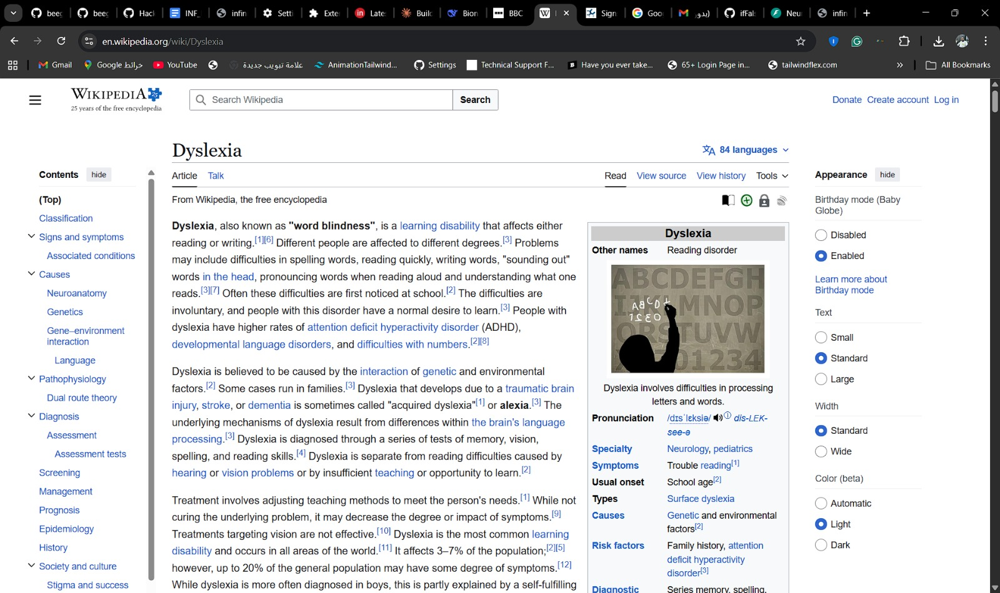
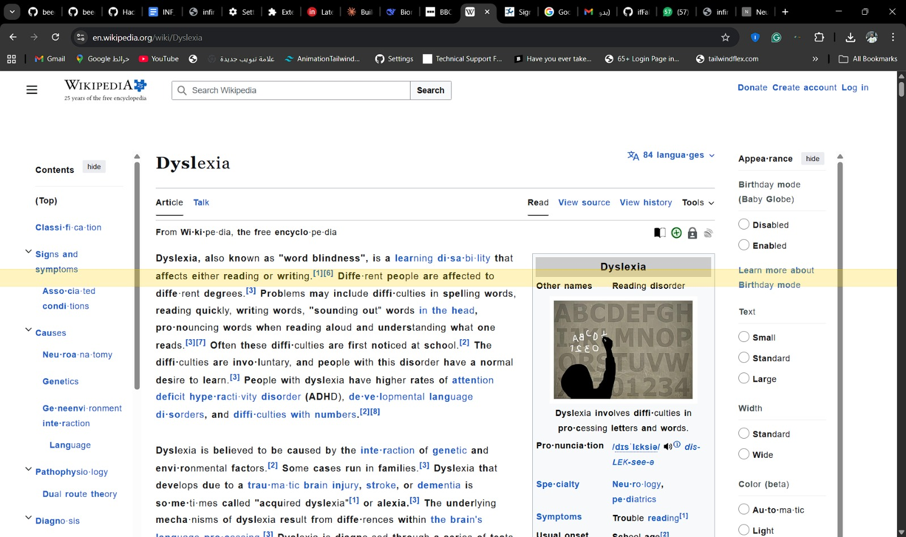
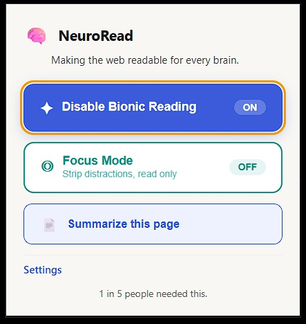
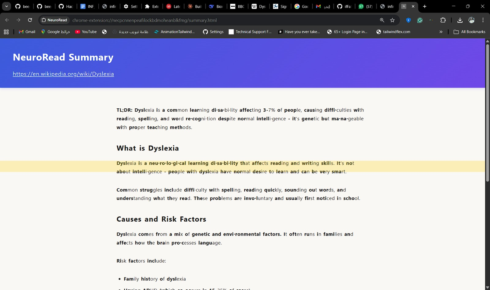

# 👋 Welcome to Hack for Infinity – Infinity 2K26!

Hey team! 🎉 Welcome to your dedicated repository for the **Infinity 2K26 Hackathon** organized by the **IEEE Computer Society OUCE Student Chapter**.

This is your team's space to build, commit, and submit your project. Organizers have access to this repo and will review your **commit history** to verify the project was built during hackathon hours — so make sure you're committing regularly throughout the day!

> ⏰ **The repository will be locked at 5:30 PM. No pushes will be accepted after that.**

---

## 📅 Quick Schedule

| Time | Activity |
|------|----------|
| 8:30 – 9:00 AM | Reporting & registration |
| 9:00 – 10:00 AM | Opening briefing & kickoff |
| 10:00 AM – 1:00 PM | Development session |
| 1:00 – 2:00 PM | Lunch break & **Round 1 evaluation** |
| 2:00 – 5:30 PM | Development session & final prep |
| 5:30 – 6:00 PM | **Final judging & presentations** |

---

## ✅ Things to Remember

- Commit your code **frequently** throughout the day
- AI tools (ChatGPT, Copilot, etc.) are allowed — but be ready to **explain your code** to the judges
- Pre-built or plagiarised projects will be **disqualified**
- Bring your laptops, chargers, and any hardware you need
- Include a **project document** in this repo (see required sections below)

---

## 📋 Judging Criteria

Projects will be evaluated on:
- 💡 Innovation and originality
- 🛠️ Technical implementation
- 🌍 Practical impact and usefulness
- 🎨 User experience and design
- 🗣️ Clarity of presentation and explanation

---

---

# 📁 Fill This In — Your Project README


---

## 🏷️ Project Title


*NeuroRead*

## 👥 Team Members

| Name | GitHub Username |
|------|----------------|
| Khalid Rashad  | Khaldosh249             |
| Abdelaziz Elrasheed  | AbdelazizS             |

## ❓ Problem Statement

*What problem are you solving? Who does it affect and why does it matter?*

Many individuals, especially those with ADHD, struggle to read and comprehend information in a cluttered online environment. The abundance of distractions on the web can make it difficult for them to focus and extract key information from articles, research papers, and other online content. This can lead to frustration, decreased productivity, and missed opportunities for learning and growth.

## 🏗️ System Architecture / Design

NeuroRead is a three-tier system: a **Chrome Extension** (client), a **FastAPI backend** (server), and a **PostgreSQL database** (persistence), all wired together with **Docker Compose**.

```
┌──────────────────────┐         ┌──────────────────────────────────┐
│   Chrome Extension   │  HTTP   │        FastAPI Backend           │
│  (JS / HTML / CSS)   │────────▶│                                  │
│                      │  JWT    │  /auth      - register, login    │
│  • Summarize button  │◀────────│  /summarize - create & list      │
│  • Bionic Reading    │         │  /feedback  - rate summaries     │
│  • Focus Mode        │         │  /settings  - user preferences   │
│                      │         │  /subscription - manage plan     │
└──────────────────────┘         │                                  │
                                 │  ┌────────────┐ ┌─────────────┐ │
                                 │  │ JWT Auth    │ │ Anthropic   │ │
                                 │  │ (bcrypt +   │ │ Client      │─┼──▶ Claude API
                                 │  │ python-jose)│ │ (summarize) │ │
                                 │  └────────────┘ └─────────────┘ │
                                 └──────────┬───────────────────────┘
                                            │ SQLAlchemy ORM
                                 ┌──────────▼───────────────────────┐
                                 │        PostgreSQL Database        │
                                 │  Users · Summaries · Feedback     │
                                 │  Settings · (Alembic migrations)  │
                                 └──────────────────────────────────┘
```

**Flow:** The Chrome Extension sends REST requests with a JWT Bearer token to the backend. For summarization, the backend fetches the target webpage, sends the content to the Anthropic API (Claude), stores the result in PostgreSQL, and returns it to the extension. All services run in Docker Compose (backend container + Postgres container).


## 🛠️ Technologies Used

*List the languages, frameworks, libraries, APIs, tools, etc. you used.*

- Backend: FastAPI, Python, SQLAlchemy, Alembic, PostgreSQL
- Chrome Extension: JavaScript, HTML, CSS
- APIs: Anthropic API for summarization
- Authentication: JWT tokens
- Deployment: Docker, Docker Compose


## ⭐ Key Features

*What are the main features of your project?*

- Summarization: Users can press the summarize button in the chrome extension to get a concise summary of the webpage content.
- Bionic Reading: The extension will highlight key phrases and important information on the webpage to help users focus on the most relevant content.
- Focus Mode: Users can enable a distraction-free mode that hides non-essential elements on the webpage, allowing them to concentrate on the main content.

## ⚙️ How It Works

*Explain how your solution works, end to end. Walk through the main flow.*

1. The user installs the chrome extension and logs in using their credentials.
2. When the user visits a webpage, they can click the "Summarize" button in the extension.
3. The extension sends the webpage URL to the backend API.
4. The backend receives the URL, calls the Anthropic API to summarize the content, and returns the summary to the extension.
5. The extension displays the summary to the user and highlights key phrases on the webpage.
6. The user can also enable "Focus Mode" to hide distractions and focus on the main content of the webpage.
7. The user can also enable "Bionic Reading" mode to enhance their reading experience.

## 🚀 How to Run

*Step-by-step instructions for running your project locally.*

```bash
git clone https://github.com/Hack-for-Infinity/ifFalse
cd ifFalse
cp .env.example .env
# Edit .env with your own values
docker compose up -d
```
Install the chrome extension by loading the `chrome-extension` folder as an unpacked extension in Chrome after editing the configuration files and replacing your domain.


## 📸Screenshots / Demo

Bionic Reading Mode off:

Bionic Reading Mode on:



Pop-up Extension:


Summary Page:
